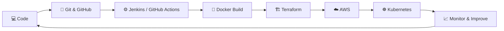
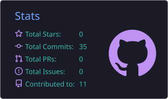
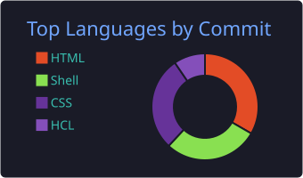
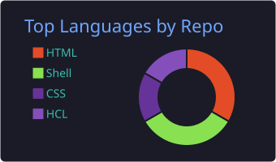
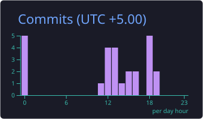

<!-- ============ HEADER ============ -->
<div align="center">


<a href="https://git.io/typing-svg">
  
</a>

<br/>


<br/><br/>

<a href="https://linkedin.com/in/mr-abhishek-birajdar"></a>
<a href="mailto:abhishekbirajdar940@gmail.com"></a>
<a href="https://instagram.com/mr_abhie_143"></a>
<a href="https://github.com/abhishek3012-ab/portfolio"></a>
<a href="https://drive.google.com/file/d/1LhxOYWvMULrACw4txssQNDkLokgm1M4o/view?usp=drive_link"></a>

</div>

<br/>

---

## 👨‍💻 About Me

```yaml
name: Abhishek Birajdar
role: DevOps Engineer (in the making)
location: Pune, Maharashtra, India 🇮🇳
focus: [AWS, Kubernetes, Docker, Jenkins, Terraform, Ansible, CI/CD]
currently_learning: Kubernetes · AWS · Terraform · GitHub Actions · Linux
looking_for: collaboration on Cloud, DevOps & Open-Source projects
fun_fact: I enjoy turning complex problems into simple solutions
```

- 🔭 Working on [Real-World DevOps & AWS Projects](https://github.com/abhishek3012-ab/jenkins-cicd-pipeline-examples)
- 🌱 Learning **Kubernetes, AWS, Docker, Jenkins, Terraform, Ansible, GitHub Actions & Linux**
- 👯 Open to collaborate on [Cloud Computing, DevOps, CI/CD & Open-Source Projects](https://github.com/abhishek3012-ab/terraform-real-world-examples)
- 🤝 Looking for help with **Advanced AWS, Kubernetes & Production-Level DevOps Projects**
- 💬 Ask me about **AWS, DevOps, Linux, Docker, Kubernetes, Jenkins, Terraform, Ansible, CI/CD, Git & GitHub**
- 📫 Reach me at **abhishekbirajdar940@gmail.com**

---

## 🛠️ Tech Stack

<div align="center">


<br/><br/>


</div>

---

## 🚀 Featured Projects

<div align="center">

<a href="https://github.com/abhishek3012-ab/jenkins-cicd-pipeline-examples">
  
</a>
<a href="https://github.com/abhishek3012-ab/terraform-real-world-examples">
  
</a>

<a href="https://github.com/abhishek3012-ab/portfolio">
  
</a>

</div>

---

## 🔄 My DevOps Workflow



---

## 📊 GitHub Stats

<div align="center">

<!-- Generated daily by .github/workflows/profile-summary.yml (no external service needed) -->






<br/>


</div>

---

## 📈 Contribution Graph

<div align="center">


</div>

---

## 🐍 Contribution Snake

<div align="center">

<!-- Generated by .github/workflows/snake.yml and published to the "output" branch -->


</div>

---

## 💡 Quote of the Moment

<div align="center">


</div>

---

<div align="center">

### 🤝 Let's Connect & Build Something Awesome!


</div>
### 🤝 Let's Connect & Build Something Awesome!


</div>
